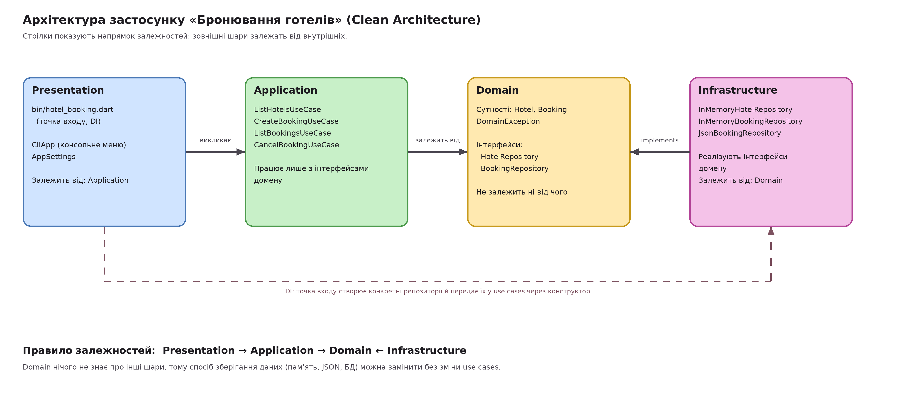
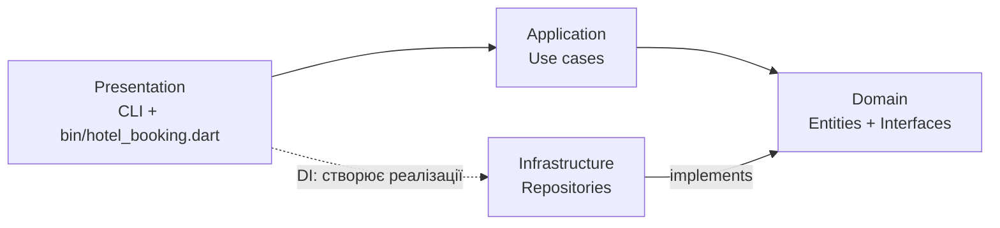

# Hotel Booking — Clean Architecture (Лабораторна робота №5)

Консольний застосунок на Dart для бронювання готелів. Проєкт демонструє
шарувату архітектуру за принципами Clean Architecture та командний процес
роботи в Git (гілки `feature/*`, pull request, Conventional Commits).

## Можливості

- перегляд списку готелів;
- створення бронювання (готель, ім'я гостя, дати заїзду/виїзду, кількість гостей);
- перегляд бронювань із назвою готелю та загальною вартістю;
- скасування бронювання;
- зберігання даних у пам'яті або у JSON-файлі (перемикається у `config/settings.json`).

## Архітектура





Залежності спрямовані лише всередину. Domain не залежить від жодного шару,
Application працює виключно з інтерфейсами `HotelRepository` та
`BookingRepository`, оголошеними в Domain (принцип інверсії залежностей).
Конкретні реалізації створюються в точці входу `bin/hotel_booking.dart`
і передаються в use cases через конструктор (Dependency Injection).

| Шар | Каталог | Вміст |
|-----|---------|-------|
| Domain | `lib/src/domain` | `Hotel`, `Booking`, `DomainException`, інтерфейси репозиторіїв |
| Application | `lib/src/application` | `ListHotelsUseCase`, `CreateBookingUseCase`, `ListBookingsUseCase`, `CancelBookingUseCase` |
| Infrastructure | `lib/src/infrastructure` | `InMemoryHotelRepository`, `InMemoryBookingRepository`, `JsonBookingRepository` |
| Presentation | `bin`, `lib/src/presentation` | точка входу, `CliApp`, `AppSettings` |

## Структура проєкту

```
hotel_booking/
├── bin/hotel_booking.dart               # точка входу, збирання залежностей (DI)
├── config/settings.json                 # налаштування (тип сховища, файл даних)
├── docs/                                # документація та схема архітектури
├── lib/src/
│   ├── domain/
│   │   ├── entities/                    # Hotel, Booking
│   │   ├── exceptions/                  # DomainException
│   │   └── interfaces/                  # HotelRepository, BookingRepository
│   ├── application/use_cases/           # use cases
│   ├── infrastructure/repositories/     # InMemory- та Json-реалізації
│   └── presentation/                    # cli/, config/
└── pubspec.yaml
```

## Вимоги

- [Dart SDK](https://dart.dev/get-dart) 3.0 або новіший (входить до складу Flutter SDK);
- Git.

## Збірка і запуск

```bash
# 1. Клонувати репозиторій
git clone https://github.com/<ваш-логін>/hotel-booking-clean-arch.git
cd hotel-booking-clean-arch

# 2. Завантажити залежності
dart pub get

# 3. Запустити застосунок
dart run bin/hotel_booking.dart

# 4. (необов'язково) зібрати виконуваний файл
dart compile exe bin/hotel_booking.dart -o hotel_booking.exe
```

Запускати команди потрібно з кореня репозиторію, бо шлях до
`config/settings.json` задано відносно нього.

## Конфігурація

Файл `config/settings.json`:

| Ключ | Значення | Опис |
|------|----------|------|
| `storage` | `json` / `memory` | Де зберігати бронювання |
| `bookingsFile` | шлях до файлу | Використовується, коли `storage = json` |
| `language` | `uk` | Мова інтерфейсу (зарезервовано) |

Щоб змінити спосіб зберігання даних, достатньо змінити `storage`: код use cases
при цьому не змінюється.

## Робота з Git

| Гілка | Призначення |
|-------|-------------|
| `main` | Стабільний код, кожен реліз позначений тегом (`v1.0.0`) |
| `develop` | Інтеграційна гілка |
| `feature/*` | Гілки під конкретні задачі (по одній на архітектурний шар) |

Повідомлення комітів оформлюються за конвенцією
[Conventional Commits](https://www.conventionalcommits.org/): `feat`, `fix`,
`refactor`, `docs`, `chore`, `merge`. Усі зміни потрапляють у `develop`
через pull request після рев'ю.
